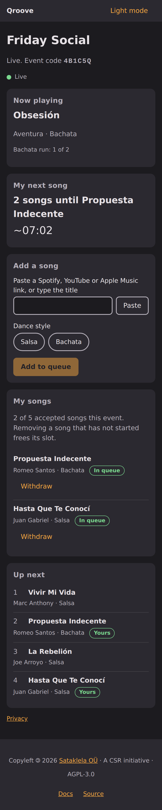

<p align="center"></p>

# Qroove

[](../../actions/workflows/ci.yml)
[](LICENSE)

Fair, collaborative music queues for dance socials.

**Live:** <https://qroove.sataklela.com> · **Docs:** <https://qroove.sataklela.com/docs>

<p align="center"></p>

Guests join an event from a QR code, add songs from a link or by title, and a fair scheduler decides the order:
a per-person song limit, no back-to-back songs from one person, and caps on how long one style can run. The
organiser controls the night; one device plays the music from local files (or in manual mode). No accounts.

## A CSR initiative

Qroove is a corporate social responsibility initiative of [Sataklela OÜ](https://sataklela.com), built for
community dance socials and free to use. It is licensed under AGPL-3.0-only so improvements stay open for
everyone. Piloted with the LSU Salsa Society (pilot community; not an endorsement). Qroove never streams or
hosts music: you play only what you are licensed to play.

## Contributing

See [CONTRIBUTING.md](CONTRIBUTING.md) (DCO sign-off required) and the
[Code of Conduct](CODE_OF_CONDUCT.md).

## Quickstart

```sh
corepack enable
pnpm install
cp .env.example .env
pnpm dev
```

See the [docs](docs/src/getting-started.md) (served at `/docs` by the app) for architecture and runbooks.
Piloted with the LSU Salsa Society (pilot community; not an endorsement).
