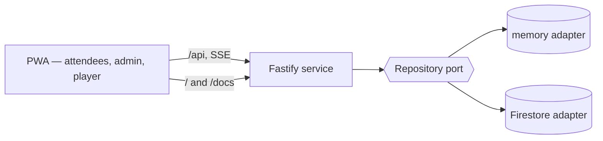

# Architecture overview

Qroove is a single Node service plus a static PWA.

## Workspaces

| Path                 | Role                                                                    |
| -------------------- | ----------------------------------------------------------------------- |
| `packages/config`    | Brand strings, style presets, rule defaults — the only place these live |
| `packages/contracts` | zod schemas shared by web and server _(Phase 2)_                        |
| `packages/scheduler` | Pure, deterministic queue scheduler _(Phase 2)_                         |
| `apps/server`        | Fastify: `/api/*`, built SPA at `/`, built docs at `/docs`              |
| `apps/web`           | React + Vite PWA                                                        |
| `docs`               | This VitePress site                                                     |

## Testing and operations

- `pnpm test` runs unit, property and API tests (memory repository); `pnpm --filter @qroove/server test:emulator`
  runs the same repository and command suites against the Firestore emulator.
- `pnpm test:e2e` (Playwright, Pixel 8; add iPhone 15 WebKit with `E2E_WEBKIT=1`) drives the built server with
  the memory repository: create, run, play manually, hand over, end and carry over, with axe checks
  (WCAG 2.2 AA, serious and critical) on every route in dark and light themes. `RATE_LIMIT_OFF=1` lets the
  suite share one IP; it is ignored in production.
- `pnpm load` simulates 40 SSE viewers and 25 contributors × 6 songs (memory, or the emulator when
  `FIRESTORE_EMULATOR_HOST` is set).
- Commands on one event are serialised in-process (memory and Firestore adapters), because they all rewrite
  the same event document; transactions still protect against a second instance.
- Retention: see [Backup and retention](/runbook/backup).

## Status

See the [changelog](/changelog) for what each release contains.
