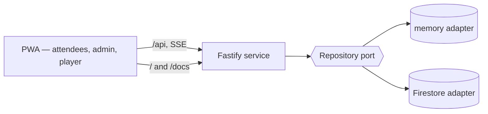

# Architecture overview

Qroove is a single Node service plus a static PWA.

## Workspaces

| Path                 | Role                                                                    |
| -------------------- | ----------------------------------------------------------------------- |
| `packages/config`    | Brand strings, style presets, rule defaults — the only place these live |
| `packages/contracts` | zod schemas shared by web and server _(Phase 2)_                        |
| `packages/scheduler` | Pure, deterministic queue scheduler _(Phase 2)_                         |
| `apps/server`        | Fastify: `/api/*`, built SPA at `/`, built docs at `/docs`              |
| `apps/web`           | React + Vite PWA                                                        |
| `docs`               | This VitePress site                                                     |

## Status

Phase 1 delivers the scaffold: health endpoint, landing page with the brand footer, docs site, Dockerfile and CI.
